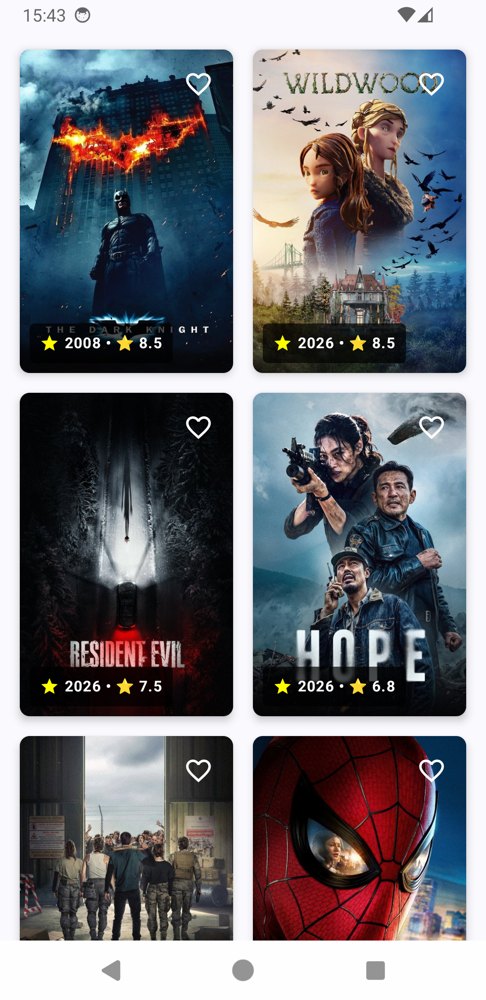
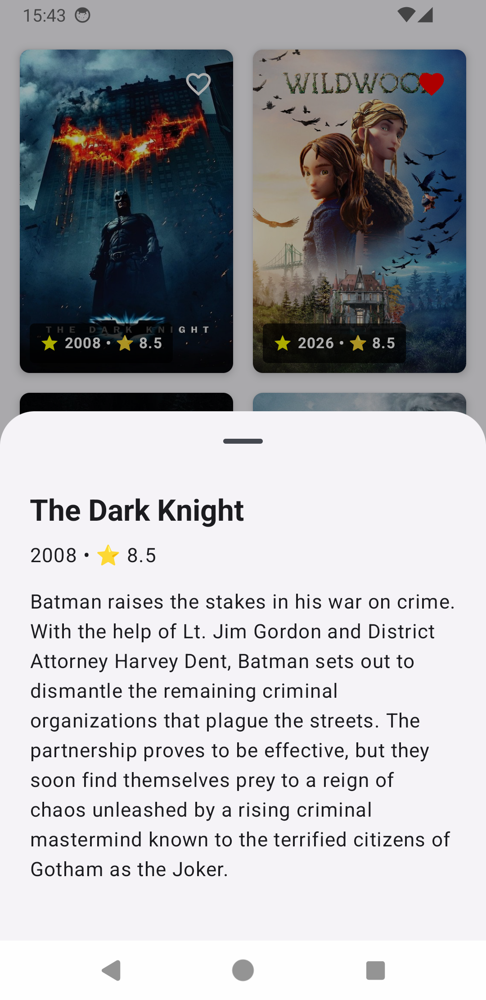

# Movie Catalog App


A robust, production-ready Android application that displays popular movies, allows users to favorite them, and supports full offline capabilities. Built with modern Android development standards, focusing on scalability, clean architecture, and edge-case handling.

## Screenshots

|              Catalog (Online/Offline)               |              Movie Details (Bottom Sheet)              |
|:---------------------------------------------------:|:------------------------------------------------------:|
|  |  |

## Architecture & Tech Stack

This project strictly adheres to **Clean Architecture** principles, separating concerns into Data, Domain, and UI layers. The UI layer is driven by the **MVI (Model-View-Intent)** pattern to ensure predictable state management.

- **UI:** Jetpack Compose, Material Design 3
- **Architecture:** Clean Architecture, MVI, ViewModel, StateFlow
- **Concurrency:** Kotlin Coroutines & Flow
- **Dependency Injection:** Dagger Hilt
- **Network:** Retrofit, OkHttp
- **Local Persistence:** Room Database
- **Pagination:** Paging 3 with `RemoteMediator`
- **CI/CD:** GitHub Actions (Ktlint, Unit Tests, UI Tests)

## Engineering Decisions & Trade-offs

* **Offline-First Pagination (`RemoteMediator`):** The app uses Room as the Single Source of Truth. The `RemoteMediator` intercepts pagination requests, fetches data from the TMDB API, and caches it locally. The UI strictly observes the database.
* **Deterministic SQLite Sorting:** A common flaw in Paging 3 implementations is data dropping or infinite loops caused by identical timestamps. To fix this, DTO-to-Entity mapping injects sequential timestamps, and the Room DAO query enforces deterministic sorting (`ORDER BY lastUpdated ASC, id ASC`), ensuring stable pagination up to thousands of items.
* **Paging Race Conditions:** To prevent the `RemoteMediator` from falsely assuming an end-of-pagination state during rapid initial loads, `initialLoadSize` was explicitly set to match the TMDB API `pageSize` (20), preventing asynchronous data drops.
* **Database Migrations:** Instead of using destructive migrations (which would wipe user favorites upon app updates), the database implements explicit `Migration` objects, maintaining schema integrity and preserving the user's local state.
* **Flicker Mitigation:** Using `enablePlaceholders = true` prevents Jetpack Compose from collapsing the `LazyVerticalGrid` height during Room invalidations (e.g., when a user favorites a movie and triggers a table update).

## Setup & Installation

This project requires a **TMDB API Key** to fetch movie data.

To ensure security best practices, the API key is not checked into version control. **I have provided a temporary API key in the submission email/message for your convenience.**

1. Clone the repository:
   ```bash
   git clone https://github.com/maiconx1/MovieCatalog.git
   ```
2. Open the project in Android Studio.
3. Open the `local.properties` file located in the root directory (create it if it doesn't exist).
4. Add the following line, replacing `API_KEY` with the key provided in the delivery email:
   ```properties
   TMDB_BEARER_TOKEN=API_KEY
   ```
5. Sync the project with Gradle files.
6. Build and run the app on an emulator or physical device.

## Testing Strategy

The project contains a comprehensive test suite targeting critical business logic and UI behavior:

- **Unit Tests:** Validates Repository logic, `RemoteMediator` delegation, and the ViewModel's MVI state machine transitions.
- **UI Tests (Compose):** Uses `composeTestRule` to verify isolated component rendering (e.g., `MovieCard`) and state-driven UI interactions on the `MovieScreen` without relying on network or database implementations.
- **Continuous Integration:** A GitHub Actions pipeline automatically triggers on every Push/Pull Request to run `ktlintCheck` and the entire test suite, ensuring no regressions enter the main branch.